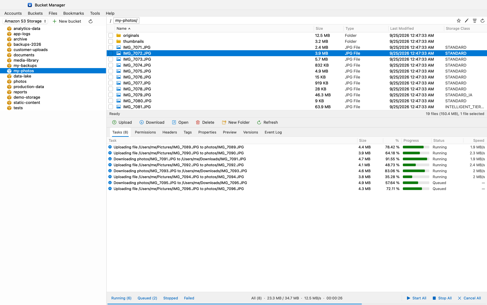
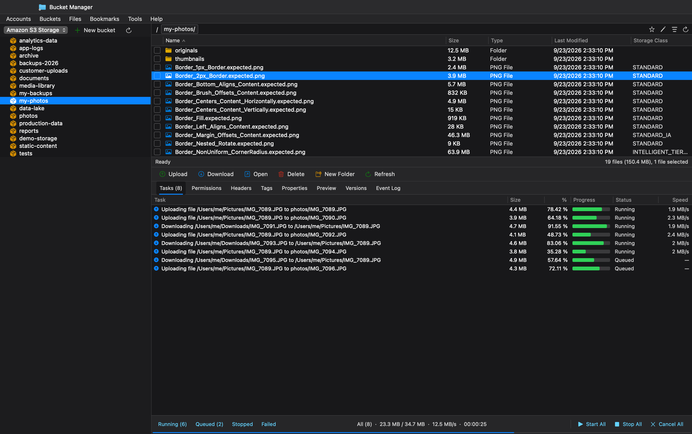
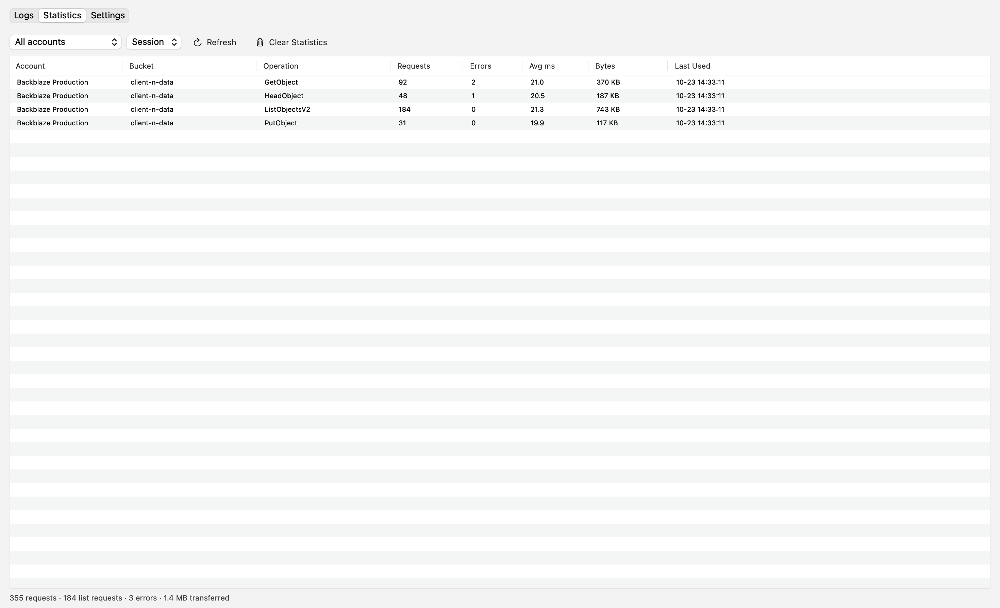
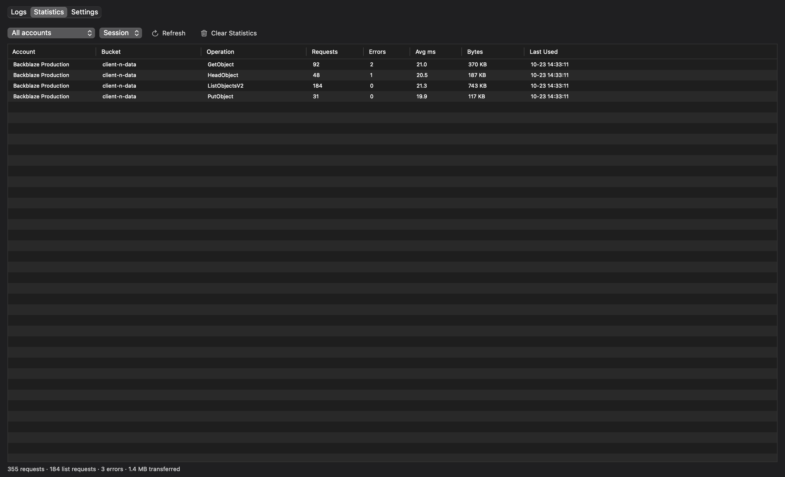
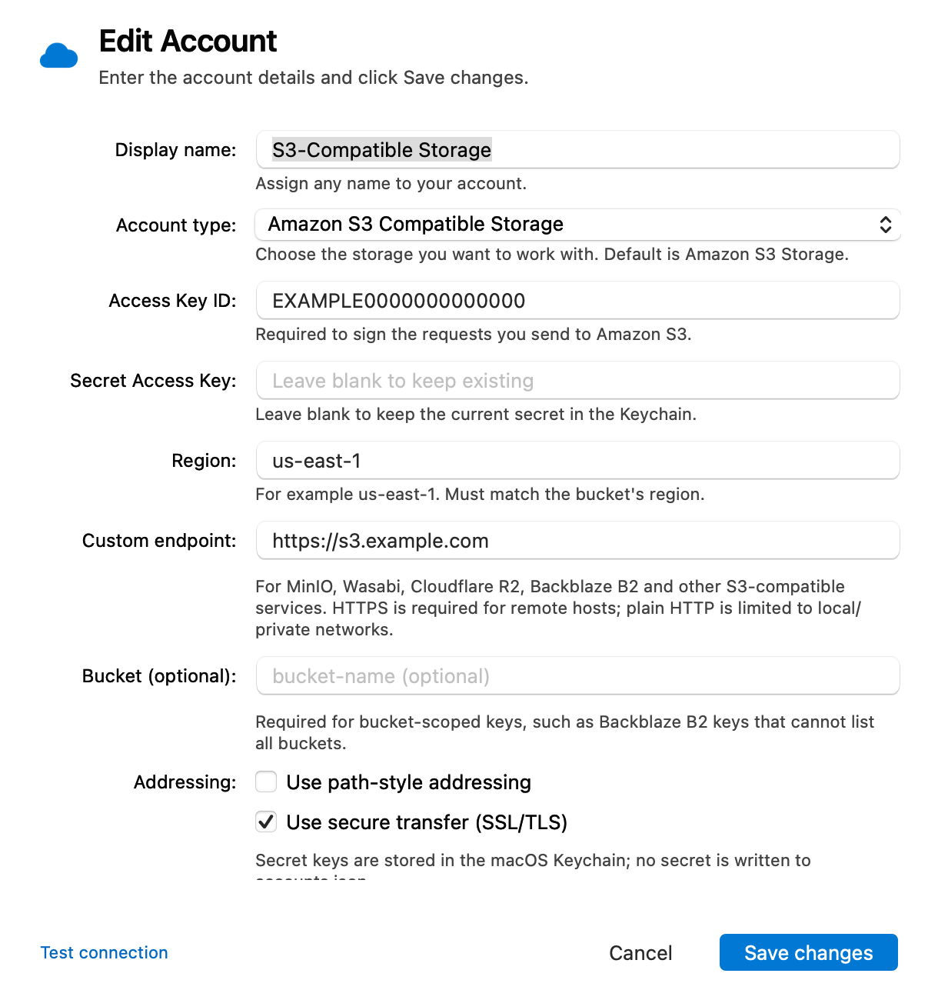
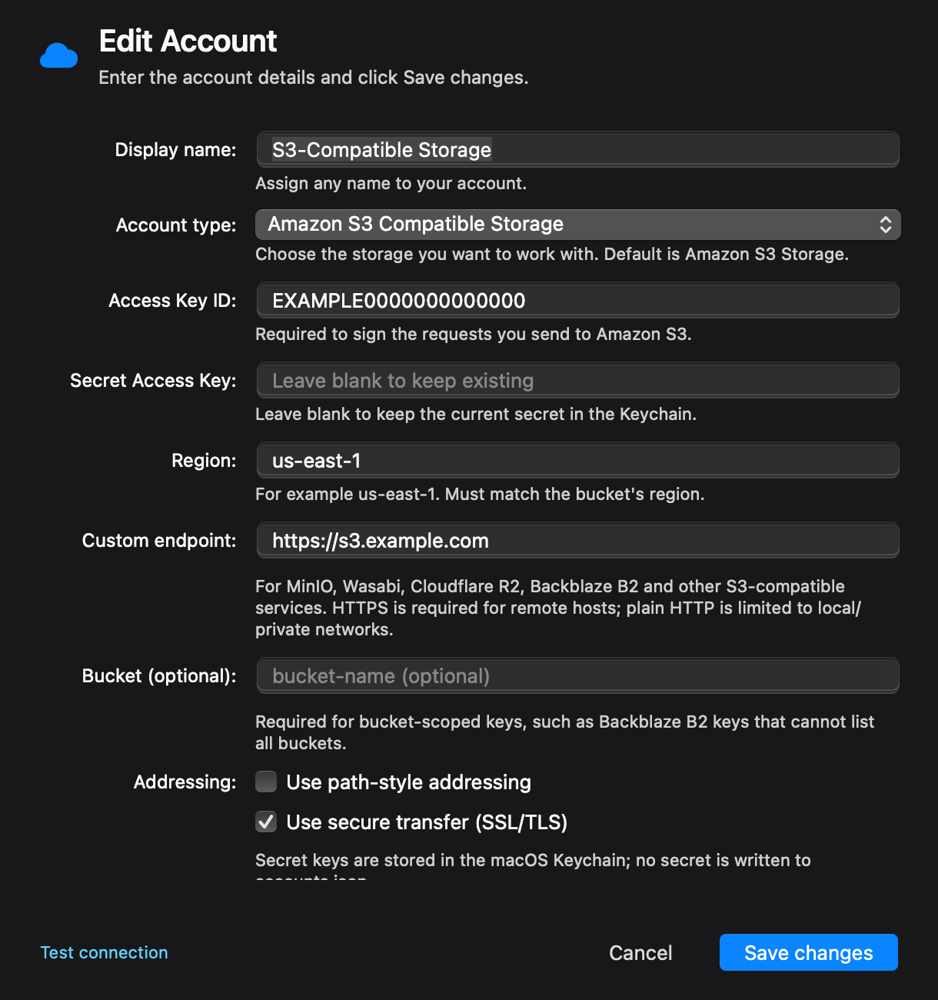

# Bucket Manager

[](https://github.com/allenhack638/bucket-manager/actions/workflows/ci.yml) [%22&replace=%241&label=macOS)](https://github.com/allenhack638/bucket-manager/releases/latest) [%22&replace=%241&label=Windows)](https://github.com/allenhack638/bucket-manager/releases?q=windows-v) [](LICENSE)

A native macOS client for S3-compatible object storage, built with AppKit and the
AWS SDK for Swift. Bucket Manager gives you an account picker and bucket sidebar, an
object browser, a transfer queue, and property, permissions, tag, version, and
event-log inspectors in one focused desktop app. A Windows app lives in
[`windows/`](windows/README.md), built with Tauri and Rust.

Bucket Manager is open source under the MIT License. Repository: https://github.com/allenhack638/bucket-manager

For the "how and why" behind the code, read **[docs/ARCHITECTURE.md](docs/ARCHITECTURE.md)**.


## Screenshots

These captures use the built-in demo account only; no real credentials or bucket data are shown.

| Browser — Light | Browser — Dark |
| --- | --- |
|  |  |

| Logs & Statistics — Light | Logs & Statistics — Dark |
| --- | --- |
|  |  |

| Edit Account — Light | Edit Account — Dark |
| --- | --- |
|  |  |

## What works

- **Unlimited accounts** — Amazon S3, S3-compatible endpoints (Linode, MinIO, Wasabi,
  Cloudflare R2, Backblaze B2, …), GovCloud, custom region, path-style addressing,
  SSL on/off.
- **Credentials** — access key metadata in Application Support, secrets in the
  **macOS Keychain**. Nothing secret is written to JSON.
- **Account dialogs** — Add/Edit Account and Storage Accounts, with validation,
  Test Connection, adaptive size, and a scrollable form on short screens.
- **Account picker → bucket sidebar → folder browser.** The sidebar lists buckets at
  bucket-level granularity for the active account; opening one browses its folders
  and objects in the right pane. Columns are resizable by dragging header dividers.
  Accounts with bucket-scoped keys (for example Backblaze B2) can set a bucket name
  in Edit Account to skip `ListBuckets`.
- **Object browser** — a clickable breadcrumb (`/ bucket/ folder/ current/`), Name,
  Size, Type, Last Modified, Storage Class; multi-select, per-row checkboxes,
  sortable headers, filter/search, and resizable columns.
- **Folder sizes and dates** — recursive prefix totals shown for every folder row
  in the current listing, with cached/refreshing/partial/unavailable states and
  sorting by the computed values.
- **Operations** — upload files, upload a folder tree, multipart upload for files
  over 16 MiB, download objects or whole folders recursively, delete objects or
  whole folders recursively, open, rename (copy + delete), copy/move to another
  bucket/prefix, cut/copy/paste, create folder, new/delete bucket.
- **Transfer queue** — real byte progress for uploads and downloads, multipart
  pause/resume, retry from completed parts, cancel with server-side abort, speed,
  a 0600 persisted queue that restores active tasks after relaunch, a concurrency
  cap of 4, running/queued/stopped/failed filters, start/stop/cancel, and open in
  Finder. Restored uploads validate source size and modification time; account
  secrets are read from Keychain only when you start the task. Startup cleanup
  removes crashed download temp files and queue-state temp files, and aborts
  orphaned multipart state.
- **Drag and drop** — drop files or folders from Finder onto the object table to
  upload them to the current prefix.
- **Inspector tabs** — Tasks, Permissions (ACL), Headers, Tags, Properties, Preview,
  Versions, Event Log. Details are loaded on demand so selecting rows does not
  bombard the endpoint.
- **Bookmarks** and **Generate Web URL** (copies a URL to the clipboard).
- **Time-limited share links** (presigned URLs, up to 7 days).
- **Version history** — restore a previous version, delete a version, or show deleted objects and undelete them.
- **Logs & Statistics** — diagnostic logging is off by default; enabling it records
  structured request/UI events by level and category. Audit logging is always on for
  account, bucket, object, transfer, and settings changes. A dedicated window provides
  search, level/category/account filters, live tail, detail inspection, redacted export,
  per-account/bucket request counters, and logging settings. Credentials, authorization
  headers, and signatures are never logged. An admin passcode is created on first access
  and stored in Keychain; opening logs/statistics, the Event Log tab, exporting, clearing,
  and changing settings require authentication. Clearing, exporting, and settings changes
  require a fresh passcode prompt even within an unlocked session. The passcode cannot
  be recovered; to reset it, delete the **Bucket Manager Admin Passcode** item in
  Keychain Access, or run
  `security delete-generic-password -s com.bucketmanager.admin -a passcode`.
- **Appearance** — native macOS **View → Appearance** with System, Light, and Dark
  modes. The custom chrome, tables, inspector, transfer footer, and menus all follow
  the selected appearance.
- **Purpose-built theme** — a restrained palette, native macOS window controls, a
  custom bucket icon, accessible controls, keyboard activation, and visible focus
  states.
- **Empty states** for no accounts, no bucket, empty folders, a failed bucket load
  (with **Retry**), and an empty queue.

## Install

### GitHub release (unsigned)

Download the latest DMG from [Releases](https://github.com/allenhack638/bucket-manager/releases),
drag **Bucket Manager** to Applications, and launch it. The current release DMG
is Apple Silicon (`arm64`); Intel Macs should build from source.

The release DMG is ad-hoc signed with Hardened Runtime but **not notarized**.
macOS will block the first launch.

### If macOS blocks the first launch

1. Open the downloaded DMG.
2. Drag **Bucket Manager** into **Applications**.
3. Open **Applications** and double-click **Bucket Manager**.
4. macOS shows “Apple could not verify…” — click **Done**.
5. Open **System Settings → Privacy & Security**.
6. Scroll down to **Security** and click **Open Anyway** next to Bucket Manager.
7. Enter your Mac password, then click **Open** in the final confirmation.
8. Bucket Manager opens normally after this once.

If **Open Anyway** is not shown, remove the quarantine flag for this app and open
it again:

```bash
xattr -dr com.apple.quarantine "/Applications/Bucket Manager.app"
open "/Applications/Bucket Manager.app"
```

Do not disable Gatekeeper globally. If you prefer a trusted local build, build
from source.

### Add your first account

1. Launch Bucket Manager and click **Add new account**.
2. Give the account a display name.
3. Paste the **Access Key ID** and **Secret Access Key**.
4. Enter the region, and for S3-compatible providers, the custom endpoint.
5. Leave **Bucket** blank for normal S3 credentials, or enter a bucket if the key
   is scoped to one bucket.
6. Enable **Use path-style addressing** only if your provider requires it.
7. Click **Test Connection**, then **Save**.
8. Pick a bucket in the sidebar, or click **New bucket**.

Secrets are stored in the macOS Keychain. Opening an account once per launch may
ask for Keychain access; choose **Always Allow** so later operations do not prompt.

### Homebrew source build (no Gatekeeper warning)

```bash
brew tap allenhack638/bucket-manager
brew install --build-from-source bucket-manager
bucket-manager
```

This builds Bucket Manager locally and installs it under Homebrew's prefix, not
`/Applications`. It requires macOS 14+ and a Swift 6.2+ toolchain. The tap is at
[allenhack638/homebrew-bucket-manager](https://github.com/allenhack638/homebrew-bucket-manager).

### Build from source

Requirements: macOS 14 or later, Xcode command-line tools, and Swift 6.2+.

```bash
git clone https://github.com/allenhack638/bucket-manager.git
cd bucket-manager
./make-app.sh release
open "build/Bucket Manager.app"
```

Or run directly from the toolchain:

```bash
swift run
```

Brand assets live in `assets/AppIcon.svg` and `assets/AppIcon.icns`; regenerate the
iconset with `swift scripts/make-icon.swift`.

For a Developer ID-signed build, pass the identity:

```bash
VERSION=1.0.0 BUILD_NUMBER=60 \
CODESIGN_IDENTITY="Developer ID Application: Your Name (TEAMID)" \
./make-app.sh release
```

See [docs/RELEASE.md](docs/RELEASE.md) for signing, notarization, unsigned DMG
creation, and verification.

### Windows app

The Windows app is a separate Tauri 2 + Rust implementation in [`windows/`](windows/README.md).
Version **0.1.4** includes:

- Multiple S3/S3-compatible accounts and Windows Credential Manager secrets
- Custom endpoints, regions, bucket-scoped credentials, and path-style addressing
- Bucket/folder browsing, paginated listings, upload/download/delete, folders
- Persistent transfer queue with live progress, pause/resume/cancel/retry
- Queued cross-account copy and move
- Multipart uploads above 16 MiB with 8 MiB parts
- System/Light/Dark appearance menu and the macOS-matching layout
- Logs & Statistics window with audit records, request metrics, and logging settings

Install the latest preview from [Windows releases](https://github.com/allenhack638/bucket-manager/releases?q=windows-v):
download the NSIS setup or MSI, then launch from the Start menu.

**The Windows installer is not code-signed yet.** Windows SmartScreen may warn on
first launch. The app is a preview and still lacks the full object inspector,
drag-and-drop, and folder upload.

Build it on Windows with Node.js 22+ and Rust stable:

```powershell
cd windows
npm ci --include=dev
cargo test --manifest-path src-tauri/Cargo.toml
npm run tauri build
```

The first launch auto-opens **Add New Account** if no account exists. Enter:

- Display name (anything)
- Account type (Amazon S3 / S3-compatible / GovCloud)
- Access Key ID and Secret Access Key
- Region (must match the bucket)
- For S3-compatible storage: the endpoint, e.g.
  `https://in-maa-1.linodeobjects.com`, and path-style if the provider requires it.

The secret is stored in the login Keychain under `com.bucketmanager.secret`
(service) / the account UUID (account), marked **accessible when unlocked, this
device only**. It is read **once per account per launch** and cached in memory, so
an operation does not re-prompt. `accounts.json` contains only the account ID,
display name, access key ID, region, endpoint and flags; it is `0600` inside a
`0700` directory. Because development builds are ad-hoc signed, macOS may still
ask for the login Keychain password once after each rebuild; click **Always Allow**.

## Request behavior

The browser is deliberately conservative with an S3 endpoint:

- Listings use 1,000 keys per page and a 60-second per-bucket/prefix cache.
- Changing bucket or folder clears the old rows immediately; a late response from
  the previous listing is discarded instead of overwriting the new view.
- The inspector fetches only the **active tab**, not every metadata type. Fetches
  are debounced 180 ms while moving through rows and cached per object for 60 s.
  In-flight requests are de-duplicated.
- Folder sizes use the only S3-valid method: a recursive `ListObjectsV2` prefix
  scan. Sibling folders are coalesced into **one parent scan**, which also caches
  nested descendant prefixes. All folder rows in the current listing trigger
  one coalesced scan, so scrolling never blanks or re-fetches rows. Navigating
  away cancels the scan. At most **2 scans** run at once, paced to **8 request
  starts per second**, capped at **100,000 objects** with a `≥` partial result.
  Failed/denied scans show `—`.
- Folder stats are **cache-first**: an on-disk cache at
  `~/Library/Application Support/BucketManager/folder-stats.json` (0600) is loaded
  at launch, so values render immediately with no request. Entries fresher than
  5 minutes are reused silently; older entries stay visible while one background
  refresh runs. Writes invalidate the affected prefix and its ancestors, and the
  cache is flushed on quit.
- Object listings and bucket lists are cached for **60 seconds**. HeadObject
  details and tags are cached in memory for **60 seconds per object**, with a
  40-object cap; failed tag loads are not cached. ACLs, versions, and previews are
  intentionally fetched again when revisited because they are security- or
  size-sensitive. Manual refresh bypasses all caches and invalidates folder stats.
- Transfers cap at four concurrent requests. Credentials are removed from queue
  memory when a task completes, fails or is cancelled.

Logs are stored as structured JSONL under:

```
~/Library/Logs/BucketManager/diagnostic-YYYY-MM-DD.jsonl
~/Library/Logs/BucketManager/audit-YYYY-MM-DD.jsonl
```

Diagnostic logging is off by default. Audit records are always retained and contain
no credentials, authorization headers, or signatures. Both use `0600` files inside a
`0700` directory. Request counters live in
`~/Library/Application Support/BucketManager/request-metrics.json` (`0600`).

## Keyboard shortcuts

| Shortcut | Action |
| --- | --- |
| ⌘N | New bucket |
| ⌘U / ⇧⌘U | Upload files / folder |
| ⌘D | Download selected |
| ⌘R | Refresh listing |
| ⌘A | Select all |
| ⌘F | Filter objects |
| ⌘X / ⌘C / ⌘V | Cut / Copy / Paste objects |
| ⇧⌘C / ⇧⌘X | Copy to / Move to |
| ⇧⌘N | Create folder |
| ⌘I | Properties |
| ⇧⌘V | Versions |
| ⌥⌘D | Show deleted objects |
| ⌥⌘N / ⌥⌘M | Add / Manage accounts |
| ⌥⌘L | Open Logs & Statistics |
| F2 | Rename |
| Delete | Delete selected |
| Esc | Go to parent folder |
| F5 | Refresh buckets and listing |
| ⇧⌘D | Dump current state to the log |
| ⌃⌘F | Enter full screen |

## Architecture at a glance

```
sources/BucketManager/
  main.swift                 entry point; debug-only diagnostic modes
  UI/
    MainWindowController     window, custom chrome, menus, sheets, shortcuts
    SidebarViewController    account picker + flat bucket list
    BrowserViewController    breadcrumb, file table, actions, status
    TransfersViewController  queue, tabs, inspector, event log
    AddAccountSheet          Add/Edit account + Storage Accounts dialogs
    Components.swift         FlatButton, checkbox, progress, InfoTextView, …
    Chrome.swift             custom title bar + in-app menu bar
    Theme.swift              theme colors, fonts, metrics
    LogsWindowController     Logs, Statistics, and logging settings
  Models/                    LogRecord, LoggingSettings, Account, S3Item, S3Key,
                             BucketNode, EndpointValidator, MultipartUploadRecord
  Services/
    S3Service                clients, listing, metadata, transfers, cache, multipart
    TransferQueue            queue, concurrency, progress, speed, resume/cancel
    MultipartUploadStore     resumable part state (0600 JSON)
    TransferQueueStore       persisted active tasks (0600 JSON, no credentials)
    LogStore                 structured JSONL logs, rotation, retention, redaction
    RequestMetricsStore      per-account/bucket/operation request counters
    AdminPasscode            Keychain passcode verifier and authorization gate
    KeychainStore            secrets
    AccountStore             account JSON + secret lookup
    StripXIDInterceptor     S3-compatible signing fix
    AppLog                   compatibility bridge into LogStore
  ViewModels/BrowserModel    state, operations, inspector loaders
  Debug harness (excluded from release builds):
  SnapshotRunner.swift       offscreen PNG rendering for UI review
  UITest.swift               headless dialog interaction tests
  E2E.swift                  fake-S3 end-to-end checks
  Acceptance.swift           real S3-protocol acceptance checks
```

## S3-compatible signing fix

Linode (and some other S3-compatible services) returned:

```
403 SignatureDoesNotMatch
```

The AWS CLI worked with the same key. Comparing requests showed the Swift SDK appends
`?x-id=ListBuckets` to every operation, while the CLI does not. Linode computes the
SigV4 canonical request without that SDK-only marker, so the signatures differ.
`StripXIDInterceptor` removes `x-id` in the `modifyBeforeSigning` phase. After that,
`listBuckets` returns all 20 buckets and `ListObjectsV2` returns `AccessDenied` only
for buckets the key is not allowed to list — i.e. the request is now correctly signed.

## Diagnostics and tests

```bash
# Headless signing probe (reads credentials from env, never logs the secret)
S3C_ENDPOINT=... S3C_REGION=... S3C_ACCESS_KEY=... S3C_SECRET=... \
  .build/debug/BucketManager --probe

# Everything: build, headless UI/model checks, then fake-S3 end-to-end checks
./scripts/test.sh

# Headless dialog/model tests (validation, breadcrumb, column resizing, paths)
.build/debug/BucketManager --uitest

# Full end-to-end suite: real AWS SDK + model + transfers against a local fake S3
./scripts/run-e2e.sh

# Real S3-protocol acceptance: local rclone SigV4 server by default
./scripts/run-acceptance.sh

# Point the same harness at a disposable external bucket/prefix.
# Add BM_ACCEPT_BUCKET_2 to exercise cross-account copy/move between two buckets.
BM_ACCEPT_ENDPOINT=https://... BM_ACCEPT_REGION=... \
BM_ACCEPT_ACCESS_KEY=... BM_ACCEPT_SECRET=... \
BM_ACCEPT_BUCKET=disposable-bucket \
BM_ACCEPT_BUCKET_2=second-disposable-bucket ./scripts/run-acceptance.sh

# Interactive credential setup, including the optional second bucket
./scripts/setup-acceptance-env.sh

# Real-account startup check (debug builds only)
.build/debug/BucketManager --verify-startup

# Offscreen UI snapshot, optional tab / empty state / window size
.build/debug/BucketManager --snapshot out.png --size 900x480
S3C_APPEARANCE=dark .build/debug/BucketManager --snapshot dark.png --size 900x480
.build/debug/BucketManager --snapshot out.png --size 900x480 --tab properties
.build/debug/BucketManager --snapshot out.png --size 900x480 --empty accounts
.build/debug/BucketManager --snapshot log-empty.png --size 1120x650 --tab log --empty log
.build/debug/BucketManager --snapshot out.png --size 900x480 --error "Access denied."
.build/debug/BucketManager --snapshot filtered.png --size 900x480 --filter Border
.build/debug/BucketManager --snapshot-sheet add --out add.png --size 640x500
.build/debug/BucketManager --snapshot-sheet edit --out edit.png --size 640x600
.build/debug/BucketManager --snapshot-sheet accounts --out accounts.png --size 760x460
.build/debug/BucketManager --snapshot-logs logs.png --size 1080x680
.build/debug/BucketManager --snapshot-logs statistics.png --size 1080x680 --tab stats
.build/debug/BucketManager --snapshot-logs settings.png --size 1080x680 --tab settings
```

The current suite is 156 dialog/model checks plus 153 end-to-end checks. The
optional acceptance harness adds a real S3-protocol pass and cleans up its test
bucket/prefix. The E2E
harness in `scripts/fake_s3.py` covers signed `ListBuckets`/`ListObjectsV2`,
folder markers returned in `Contents`, AccessDenied, deliberately delayed
responses, folder creation (`PUT .../name/`), metadata request counts, the 60s
listing cache, parent-coalesced folder scans, nested descendant caching,
persistent cache reload (including a fresh model instance with zero requests),
paginated/cancelled/partial scans, folder-size sorting, 2-scan and 8 req/s
pacing, the global 4-request cap, cross-bucket folder paths, downloads and
uploads, multipart thresholding, pause/resume, part persistence, cancellation,
changed-file invalidation, injected part failure/retry, and abort-on-cancel.

`S3C_A11Y=1` adds an accessibility audit (missing labels on interactive controls).
`S3C_LOG=1` turns on AWS SDK request logging (debug builds only; signatures and
headers, never the secret).

## Known limits

- Folder sizes are bounded snapshots: they scan up to 100,000 objects for the
  folder rows in the current listing and can be disabled in Options. Cached
  values persist across
  app restarts; external changes become visible after the cache is refreshed or
  invalidated by this app's own writes.
- Uploads up to 16 MiB use a single explicit-length PUT. Larger uploads use
  multipart with 8 MiB parts, four concurrent parts, persisted part state,
  pause/resume, retry, and abort-on-cancel. Paused, queued, running, and failed
  tasks are restored after relaunch as paused/failed with their account identity,
  progress, and local file path. Uploads whose source disappeared or changed are
  marked failed instead of being silently resumed. Incomplete server-side
  uploads should be covered by a bucket lifecycle rule.
- Downloads resume from the persisted byte offset with a Range request and ETag validation. If the ETag changes or the server ignores Range, they restart safely. They stream to an owner-only temporary file, verify the received length when available, and replace the destination only on success; cancellation removes the temporary file without touching the existing destination.
- Cross-account copy/move is available through **Copy to…** and **Move to…**. Files
  and folders are queued through an owner-only temporary file; the destination is
  verified before a move deletes the source. Existing destination keys are checked
  and refused before transfer (best effort; concurrent writers can race). See
  [docs/CROSS_ACCOUNT_TRANSFER.md](docs/CROSS_ACCOUNT_TRANSFER.md).
- Advanced bucket administration (ACL, policy, lifecycle, CORS, website, replication)
  is not implemented and is tracked in [docs/BACKLOG.md](docs/BACKLOG.md).
- Preview renders common image formats and UTF-8 text; other binary objects show a size summary.
- Tags, metadata, and ACLs are read-only. Show Deleted Objects scans up to 10,000 versions per folder.
- Diagnostic logs default off and are pruned after 14 days; audit logs are always on
  and retained for 90 days. Request counters persist across launches; session and
  all-time totals are shown in Statistics.
- GitHub release builds are ad-hoc signed with Hardened Runtime and are not
  notarized; macOS requires a one-time **System Settings → Privacy & Security → Open Anyway** step or quarantine removal.
  Developer ID signing and notarization remain optional for trusted distribution.
  Ad-hoc rebuilds may re-prompt for Keychain access.
- The app is not App Sandboxed; see [SECURITY.md](SECURITY.md) for the migration
  requirements before enabling it.
- The window uses native macOS traffic lights at top-left; offscreen snapshot
  images do not include the native titlebar controls.

## Contributing

See [CONTRIBUTING.md](CONTRIBUTING.md) for build, test, and review guidance.
Security reports should follow [SECURITY.md](SECURITY.md). Community participation
is covered by [CODE_OF_CONDUCT.md](CODE_OF_CONDUCT.md). Third-party licenses are
listed in [THIRD_PARTY_NOTICES.md](THIRD_PARTY_NOTICES.md).

## License

Bucket Manager is released under the MIT License. See [LICENSE](LICENSE).
The Bucket Manager name and icon are not licensed for use as another project's
branding.
