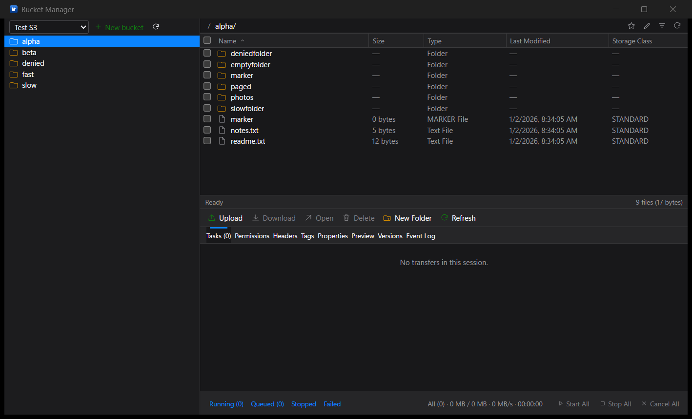

# Bucket Manager for Windows

A Tauri 2 desktop client for S3-compatible object storage on Windows.

This is the Windows preview. It shares the repository, fake-S3 fixtures, and
acceptance expectations with the macOS app, but the UI and S3 layer are a
separate Rust + React implementation.



## Current features

- Multiple S3 and S3-compatible accounts.
- Access key metadata in `%APPDATA%\BucketManager\accounts.json`.
- Secrets in **Windows Credential Manager**, never in the JSON file.
- Bucket-scoped credentials for providers that deny `ListBuckets`.
- Custom endpoints, regions, and path-style addressing.
- Bucket sidebar and folder/object browser with breadcrumbs.
- Upload, download, create folder, and delete objects or folders.
- Paginated listings.
- Persistent transfer queue with live progress, pause/resume/cancel/retry.
- Multipart uploads above 16 MiB with 8 MiB parts, verified against fake S3 and real MEGA S4 in both test buckets.
- System/Light/Dark appearance menu.
- macOS-matching layout: 321 px sidebar, 24 px path bar, 24 px header, 18 px rows, 30 px action bar, 28 px tabs, 40 px transfer footer.

## Not in the preview yet

- Cross-account copy/move.
- Full inspector tabs and logs/statistics.
- Drag and drop and folder upload.
- Copy resume across relaunch; paused queue tasks restart from the beginning.
- Code signing; the installer is unsigned and may trigger SmartScreen.
- Automatic updates.

## Development

Requirements:

- Node.js 22+
- Rust stable
- Microsoft C++ Build Tools and WebView2 (installed by the Windows runner)

```powershell
cd windows
npm install
npm run tauri dev
```

## Build the installers

```powershell
cd windows
npm ci --include=dev
npm run build
cargo test --manifest-path src-tauri/Cargo.toml
npm run tauri build
```

Artifacts:

- `src-tauri/target/release/bundle/nsis/*.exe`
- `src-tauri/target/release/bundle/msi/*.msi`

## Release

Push a tag matching `windows-v*`:

```bash
git tag -a windows-v0.1.3 -m "Bucket Manager for Windows 0.1.3"
git push origin windows-v0.1.3
```

Download version 0.1.3 from [Windows releases](https://github.com/allenhack638/bucket-manager/releases?q=windows-v).
The `Windows release` workflow builds and publishes both installers. The installer
is not code-signed yet, so Windows SmartScreen may warn on first run.
